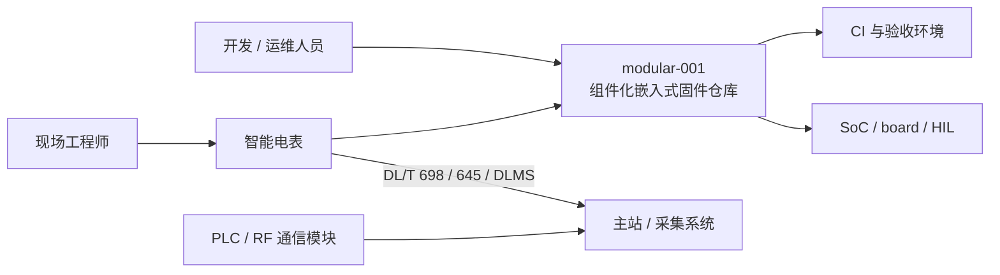
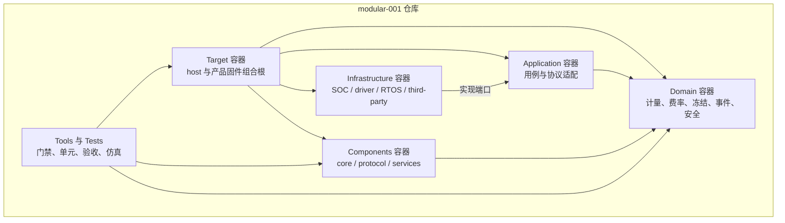
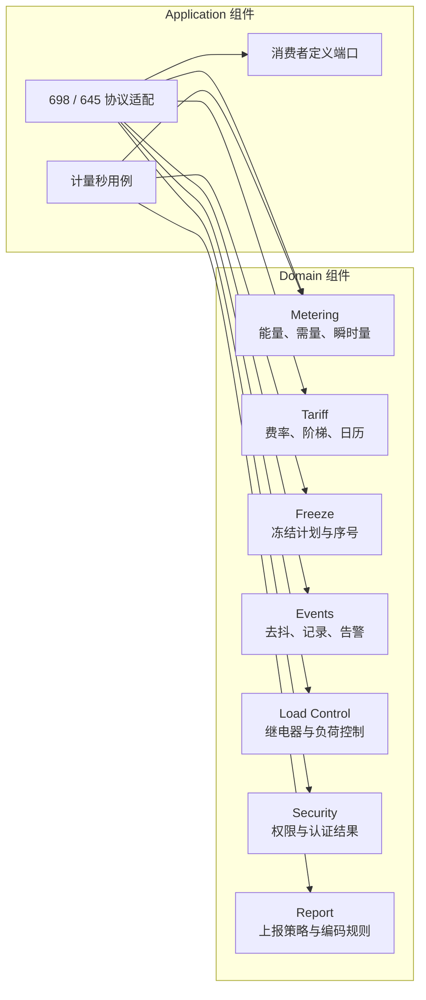
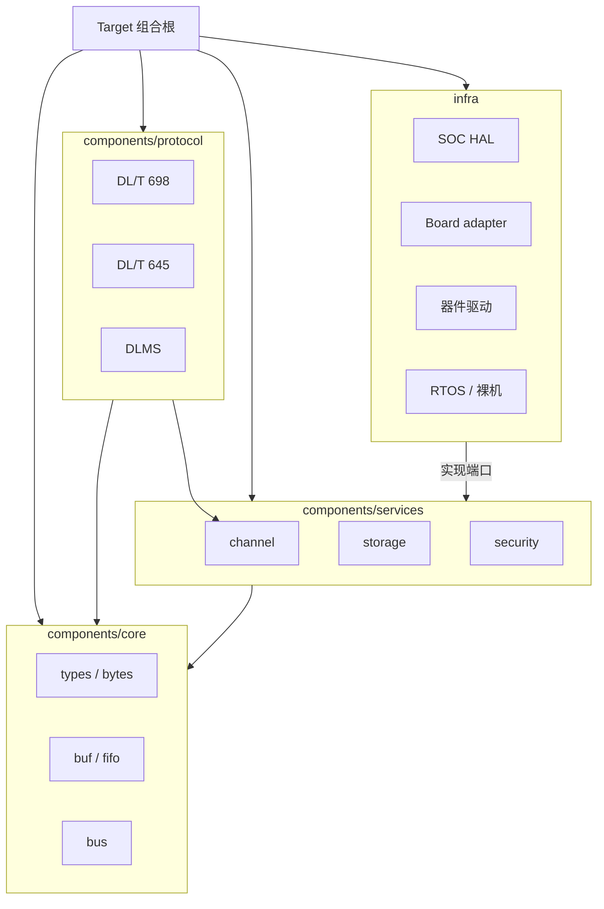
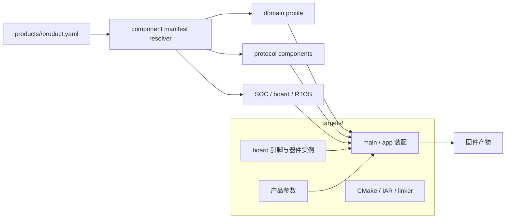
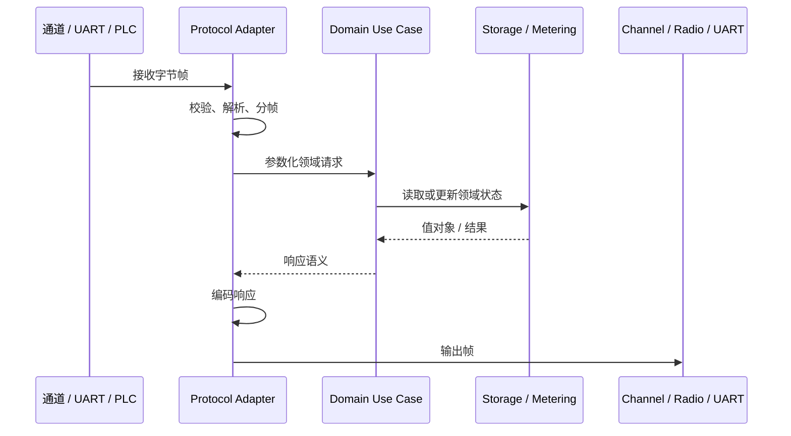
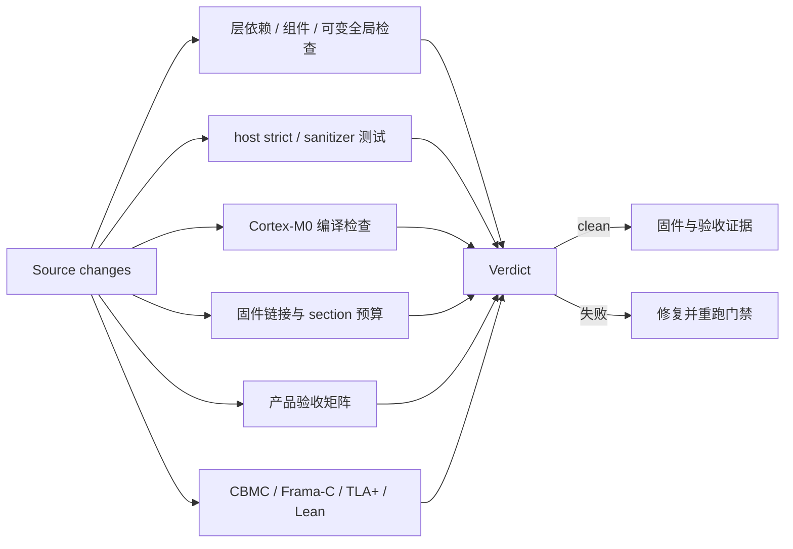

# modular-001

`modular-001` 是一个面向智能电表、通信模块及多 SoC、board、RTOS 产品的组件化 C11 单体仓库。项目使用领域驱动的分层架构、消费者定义端口和 target 组合根装配，目标平台以 Cortex-M0 为主，并保留存量设备 EEPROM 布局兼容。

## 当前状态

- 主语言为 C，并包含少量 Python、Assembly、CMake、C++ 和 Go。
- 已落地领域、应用、协议、服务、基础设施和产品 target 分层。
- 支持裸机及 FreeRTOS 构建。
- 当前产品包括国网状态表、两个 IDIS IP 电表 target 和 host 仿真 target。
- 业务组件和平台组件通过 `product.yaml` 选择。
- 持久化兼容、依赖方向、组件归属、Cortex-M0 编译和固件链接受自动检查约束。

## 仓库布局

| 路径 | 职责 |
|---|---|
| `domain/` | 纯领域能力：计量、费率、冻结、事件、负荷控制、显示、安全、上报等 |
| `application/` | 用例编排和协议适配器 |
| `components/` | 可复用 core、domain、application、protocol 和 services 组件 |
| `infra/` | SoC、驱动、RTOS、第三方代码及基础设施适配 |
| `targets/` | 产品组合根、board 包、应用入口、配置和构建脚本 |
| `products/` | 产品描述：组件选择与平台选择 |
| `tests/` | 主机单元测试、验收用例、协议语料和仿真测试 |
| `formal/` | CBMC、Frama-C/Eva、TLA+ 和 Lean 形式化验证 |
| `tools/` | 架构门禁、构建清单、固件检查和验收工具 |
| `docs/` | 架构、平台、协议、验证和迁移文档 |

## 架构约束

- `domain` 不依赖平台、协议或具体 target。
- `application` 依赖领域契约，并通过消费者定义的端口工作。
- `components` 不得直接依赖 SoC、board、RTOS、target 或产品目录。
- `targets/<product>` 是唯一装配点：创建对象、绑定端口、启动调度。
- 平台差异只出现在 `infra/soc`、`infra/drivers`、`infra/rtos` 和产品 board。
- 聚合和资源由调用方持入或注入，不读可变全局状态，不由 domain 调用宿主 `malloc`。
- 存量电表持久化布局必须逐字节兼容；布局偏移由静态断言和回归测试锁定。

## C4 模型

下面的七张图按 C4 模型的四个抽象层及关键横切视图组织。

### 1. 系统上下文



### 2. 容器视图



### 3. 组件视图：领域与应用



### 4. 组件视图：可复用组件与基础设施



### 5. 产品装配视图



### 6.运行时交互：协议帧到领域用例



### 7. 验证与交付流水线



## 构建与验证

仓库提供统一入口：

```bash
./ci.sh
```

常用验证内容包括：

- `host:strict` 与 sanitizer 测试。
- `host:sim-san` 整机仿真。
- Cortex-M0 严格编译。
- 层、组件、平台边界和可变全局检查。
- 产品清单、固件链接和 ROM/RAM 预算检查。
- stategrid 与 IDIS 验收矩阵。
- CBMC、Frama-C Eva、TLA+ 和 Lean 形式化检查。

补充架构文档：

- [架构层与依赖规则](docs/architecture.md)
- [组件化 monorepo 设计](docs/monorepo.md)
- [平台目录与可见性规范](docs/platform-layout.md)
- [ROADMAP](docs/ROADMAP.md)
- [组件标准](docs/guides/component-standard.md)
- [端口绑定](docs/guides/port-binding.md)
- [验证分层](docs/guides/verification.md)
